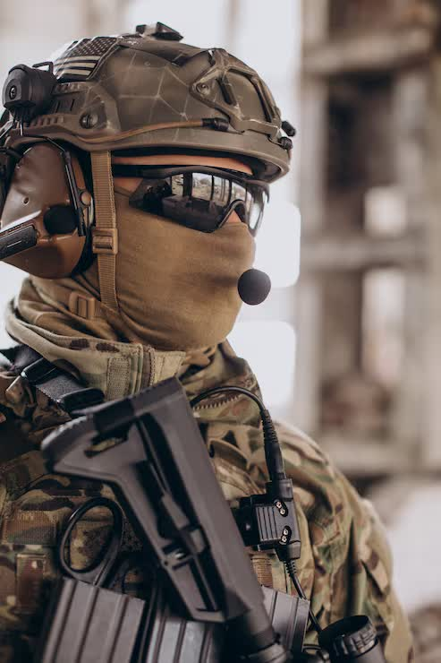

## Dhwani-Kavach
**High-SPL dual-microphone speech enhancement on a Raspberry Pi 5**


## What it is

Two I2S MEMS microphones wired **directly to the Raspberry Pi 5** (no
microcontroller, no USB hop) feed a streaming pipeline:

```
mic A (primary, faces the lips)  \                                   +--> headphones / radio
                                  >-- guard -> stage 1 -> AGC -> neural -> limiter
mic B (reference, faces away)    /
```

* **Stage 1** is a geometry-aware dual-mic front-end: a differential beamformer
  or a generalised sidelobe canceller, cross-faded in with the noise level.
* **Stage 2** is FastEnhancer-B (causal RNNFormer) on ONNX Runtime, fine-tuned on
  the stage-1 output of the synthetic battlefield set (same size and compute as the
  stock model).
* **Level management** (slow AGC before the model, lookahead limiter after it)
  and fault containment (the audio path never raises) wrap both stages.

## Results on the synthetic bench

144 real-speech scenes (6 noise types x 4 SPL bands at the mic, 90-138 dB), the
recommended preset `ft_gsc_blend_agc12` against the AI-only baseline, operating
range (< 130 dB), paired-bootstrap 95 % intervals, **accepted by the
non-regression gate** (full tables in `docs/EVAL_REPORT.md`):

| metric | improvement over AI-only | 95 % CI |
|---|---|---|
| ESTOI (intelligibility) | +0.161 | 0.131 .. 0.193 |
| SI-SDR | +2.2 dB | 0.8 .. 3.7 |
| PESQ-WB | +0.34 | 0.26 .. 0.41 |
| voiced frames with pitch preserved | +9.8 points | 6.7 .. 13.2 |
| syllabic-rhythm correlation | +0.22 | 0.18 .. 0.26 |

The legacy pipeline (hard-gated NLMS) scored ESTOI 0.12 against 0.39 for the
*untouched microphone*: in this geometry the reference mic hears the talker only
2 dB quieter, so an NLMS "noise reference" cancels speech. On the development PC
the recommended pipeline costs about 58 % of the legacy pipeline's time per block
(1.13 vs 1.95 ms; the Pi has not been measured). Everything is simulated: see
the limits below and section 8 of the report.

## Honest status

* The system is validated on a **synthetic bench**, not on real hardware or real
  battlefield recordings. Read `docs/EVAL_REPORT.md` for what was measured.
* **130 dB SPL exceeds the INMP441's 120 dB overload point.** At the top SPL band
  the capture clips on most samples and no software stage recovers speech. The
  bench quantifies how much a higher-AOP microphone would help.
* Earlier README claims (0.000 ms phase drift, < 22 ms glass-to-glass,
  18-25 dB noise reduction, a "Delayless VSS Hybrid") were not supported by the
  code or by measurement and have been removed. The measured neural-stage delay
  is 10.7 ms; the realistic latency budget is in `docs/HARDWARE_ARCHITECTURE.md`.

## Repository map

```
src/highspl/
  pipeline.py        the single streaming pipeline (lab UI, evaluator and Pi share it)
  dsp/               front-ends (beamformer, legacy NLMS/FDAF), AGC + limiter, calibration, drift
  data/              synthetic dual-mic scene generator (speech, noise, geometry, hardware model)
  evaluation/        metrics, speech-property scorecard, streaming runner, report + gate
  training/          dataset builder and fine-tuning loop
  models/            FastEnhancer streaming adapter (ONNX Runtime / PyTorch)
laboratory/          PyQt6 lab UI and capture code
scripts/             generate_mixtures, evaluate, hardware_sweep, train, export, benchmark
configs/pipelines/   pipeline presets (B0 = legacy baseline, bypass, diff, gsc, gsc_blend, ...)
docs/                hardware, mathematics, synthetic-data and evaluation documents
```

## Quick start

```bash
git clone <your-fork-url> && cd ANCMicModel
uv sync                              # developer machine: runtime + dev + eval + train
uv sync --no-default-groups          # Raspberry Pi: runtime only (no torch / GUI / eval)
uv sync --group lab                  # + the desktop lab UIs (PyQt6, pyqtgraph, customtkinter)
```

The ONNX models are not in git (`*.onnx` is ignored). The lab app and live UI pick the
best preset whose model exists (`ft_gsc_blend_agc12` -> `gsc_blend_agc12` -> `bypass`;
override with `HIGHSPL_PRESET`). Build the stock model by exporting it from the checkpoint
in `models/fastenhancer/fastenhancer_b.zip` (unzip `00500.pth` and `config.yaml`
into `models/fastenhancer/b/`):

```bash
git clone https://github.com/aask1357/fastenhancer third_party/fastenhancer   # MIT
uv run python scripts/export_fastenhancer_b.py
```

To rebuild the fine-tuned model (about 10 minutes of GPU after the data is rendered):

```bash
uv run python scripts/make_train_set.py --preset gsc_blend_agc12 --n 2000 --n-val 200
uv run python scripts/train.py --data data/generated/train_gsc_blend_agc12 --epochs 8
uv run python scripts/export_fastenhancer_b.py --checkpoint artifacts/finetune/best.pth     --output models/fastenhancer/b/ft_gsc_blend_agc12.onnx
```

### Run the lab UI

```bash
uv run --group lab python -m laboratory.main
```

### Reproduce the evaluation

```bash
uv run python scripts/download_data.py                              # LibriSpeech (CC BY 4.0)
uv run python scripts/generate_mixtures.py --set eval_v1 --workers 8
uv run python scripts/evaluate.py --set eval_v1 --pipelines B0,bypass,gsc_blend --baseline bypass
uv run python scripts/hardware_sweep.py --pipeline gsc_blend        # AOP / spacing / distance
```

### Benchmark on the Pi

```bash
uv run python scripts/benchmark_pi5.py --preset gsc_blend --seconds 60
```

The verdict gates on the **99.9th-percentile** block time against the 10.67 ms
deadline, not on the mean.

## Documents

* `docs/HARDWARE_ARCHITECTURE.md` - wiring, Pi bring-up checklist, latency budget
* `docs/MATHEMATICAL_FRAMEWORK.md` - the algorithms as implemented
* `docs/SYNTHETIC_DATA.md` - the noise/speech models and the hardware chain
* `docs/EVAL_REPORT.md` - measured results and the decisions they drove

## Contributing

Run `uv run ruff check . && uv run ruff format --check . && uv run pytest`.
Every change to the signal path must pass the non-regression gate
(`highspl.evaluation.report.gate`) against the current baseline on the
evaluation set.
